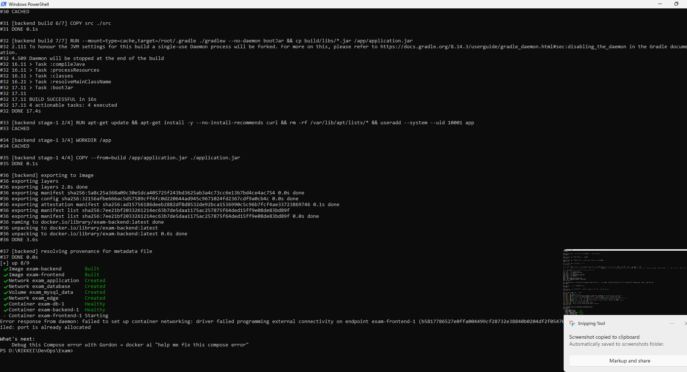
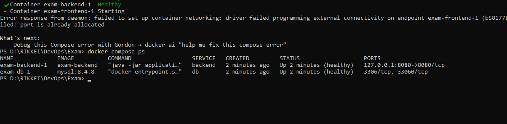
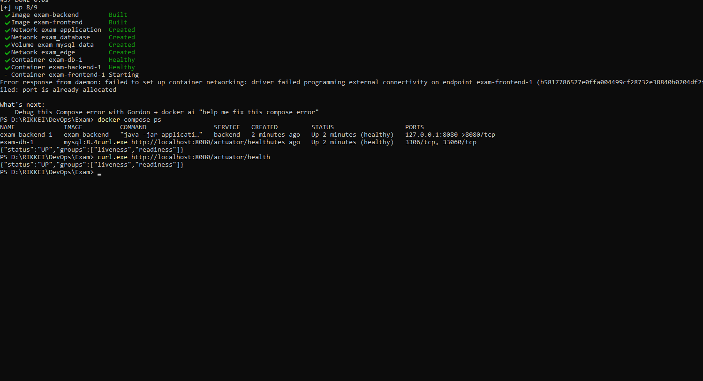

# Campus Hub Base

## 5. Minh chứng kết quả thực hiện (Phần 1)

### Thông tin sinh viên
- **Họ và tên**: Phạm Tiến Hưng
- **Mã sinh viên**: 242

### Lệnh dùng để chạy hệ thống
1. Chuẩn bị file biến môi trường từ template mẫu:
```bash
cp .env.example .env
```
2. Khởi động toàn bộ dịch vụ (MySQL, Backend Spring Boot, Frontend Nginx) với Docker Compose:
```bash
docker compose up -d --build
```
3. Kiểm tra trạng thái hoạt động của các dịch vụ:
```bash
docker compose ps
```
4. Dừng hệ thống khi không sử dụng:
```bash
docker compose down
```

### Cổng và URL kiểm tra hệ thống
- **URL kiểm tra Backend (/actuator/health)**: 
  - Trực tiếp Backend: `http://localhost:8080/actuator/health`
  - Hoặc qua Nginx Reverse Proxy: `http://localhost:8088/actuator/health`
- **Cổng Backend API**: `8080` (trực tiếp) hoặc `8088` (thông qua prefix `/api/` của Nginx)
- **URL Frontend Web**: `http://localhost:8088`

### Ảnh chụp minh chứng kết quả làm bài

#### 1. Docker Image đã build thành công
> Thể hiện danh sách images sau khi build (`docker images` hoặc kết quả terminal khi build xong):



#### 2. Trạng thái các service sau khi chạy Compose
> Thể hiện kết quả lệnh `docker compose ps` (các container `db`, `backend`, `frontend` đều ở trạng thái `running` / `healthy`):


#### 3. Kết quả gọi /actuator/health
> Thể hiện kết quả truy vấn HTTP GET tới `/actuator/health` trả về HTTP 200 và `{"status":"UP"}`:


---
